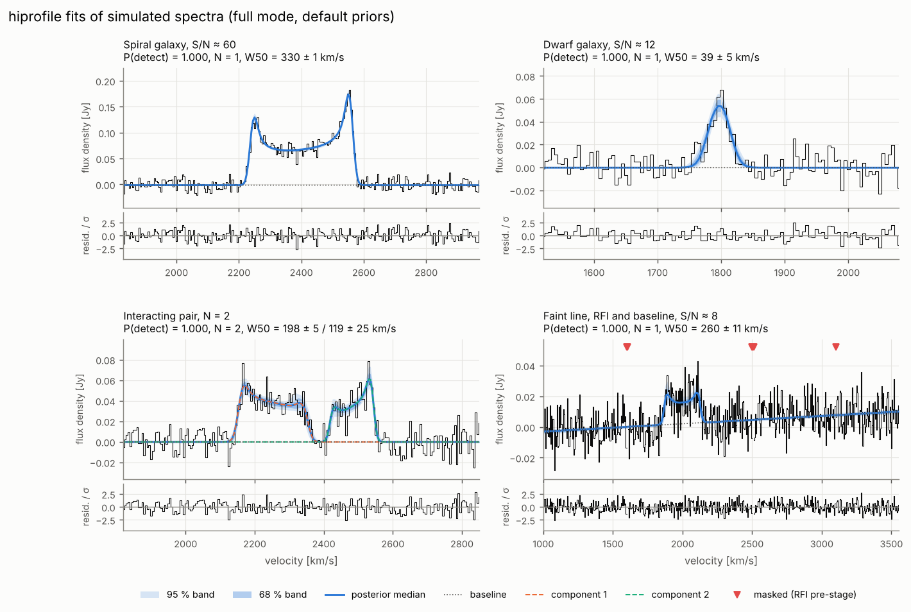

# hiprofile

Bayesian fitting of global HI line profiles with the model of
Stewart, Blyth & de Blok (2014, A&A 567, A61): posteriors, evidences for
N = 0, 1, 2, … components, detection probabilities, catalogue, diagnostics and
plots for whole spectrum lists.

```bash
uv pip install -e ".[all]"
hiprofile fit spectra.txt --config examples/survey.yaml --jobs 32 --out results/
```



*Simulated spectra fitted with the default configuration: posterior median
with 68/95 % bands, components and normalised residuals. Bottom right: a
faint line next to RFI spikes and a 3-channel RFI burst, which the robust
pre-stage masks (triangles).*

Per spectrum, `results/spectra/<id>.h5` holds weighted posterior samples
(including W50, W20, flux and systemic velocity), evidences for every N and
Chebyshev baseline order K, P(detect), quality metrics and flags;
`results/catalog.fits` and `results/report.html` summarise all spectra.

## How it works

* **Model kernel** (`hiprofile.model`): ring and disk basis functions evaluated in
  Fourier space (Bessel functions, Gaussian, exact channel integration and
  Hanning/Tukey responses); compiled with numba by default, NumPy fallback, and
  JAX (`jit`, `vmap`, gradients). Five parameters per component are
  nonlinear: v_ctr, Δv, Δv_rand, α, f. A full fit of a 512-channel spectrum
  (N ≤ 2, K ≤ 3) takes 3–10 s on one core.
* **Likelihood** (`hiprofile.likelihood`): the flux, the Chebyshev baseline *and
  the baseline order K* are marginalised analytically (Woodbury, one Cholesky
  for all K); half-normal flux prior with exact positivity; white or
  Hanning-correlated noise; masks; a robust outlier-mixture pre-stage for RFI.
* **Samplers** (`hiprofile.samplers`): tempered SMC (default, fastest), nautilus
  (most precise evidences), dynesty, UltraNest and a quick MAP + Laplace +
  importance-sampling mode behind one interface; `--mode quick | full | check`.
* **Model comparison** (`hiprofile.inference`): one sampler run per N gives
  the evidences for all N and K (Poisson prior on N, flat prior on K) and a
  posterior marginalised over K.
* **Validation** (`hiprofile simulate`, `hiprofile validate`): simulation-based
  calibration, detection/confusion statistics, misspecified profiles,
  baselines and RFI, injection into real spectra; always compared with two
  classical width measurements on the same data (naive threshold crossing
  and the edge fits of Springob et al. 2005), which the catalogue also
  reports.
* **Survey runs**: process pool (`--jobs`), SLURM arrays (`--chunk i/n`),
  atomic per-spectrum files, `--resume`, per-spectrum seeds.

The original Cython code is kept in `legacy/` as frozen reference; the new
kernel reproduces it to 1e-11 (golden files in `tests/reference/`).

Documentation: `docs/` (`mkdocs serve`): [model](docs/model.md),
[inference](docs/inference.md), [outputs and flags](docs/outputs.md),
[configuration](docs/configuration.md), [tutorial](docs/tutorial.md),
[validation](docs/validation.md), [legacy code](docs/legacy.md).

## Priors

Defaults calibrated on the 34 THINGS fits of Stewart et al. (2014) and,
for the rotation width Δv, on the ALFALFA α.100 W50 distribution; the
simulator draws from the same priors. Details in [docs/priors.md](docs/priors.md).


## Validation

From `benchmarks/validate_all.sh` ([docs/validation.md](docs/validation.md)):
1000 spectra simulated from the priors are calibrated (rank statistics and
interval coverages) and the baseline order is recovered in 93 % of the
cases. The posterior medians of W50, W20 and v_sys are unbiased and scatter
half as much as either classical measurement on the same unsmoothed
spectra. On Hanning-smoothed spectra above S/N 15, and at S/N 8 for lines
up to Δv = 100 km/s, the Springob et al. (2005) W50 is as good as the
posterior median; the fit still gives the better W20 (the naive one is up
to 60–100 km/s too wide for broad lines), keeps working for wide lines at
S/N 5–8 and on unsmoothed channels, where the edge fits break down, and
adds calibrated uncertainties, detection
probabilities and blended components. With the RFI pre-stage no line-free
spectrum with RFI spikes is detected; deliberately wrong models
(standing-wave baselines, unmasked RFI) are flagged in 98–100 % of the
cases; and ten low-S/N ALFALFA sources agree with the catalogue except
where a neighbour shares the beam.


## Development

```bash
uv venv && uv pip install -e ".[dev]"
pytest              # fast tests incl. golden files
pytest -m slow      # nested samplers, full mode
ruff check hiprofile tests && mypy hiprofile
```

## Citation

See `CITATION.cff`; please cite Stewart, Blyth & de Blok (2014) for the model.
