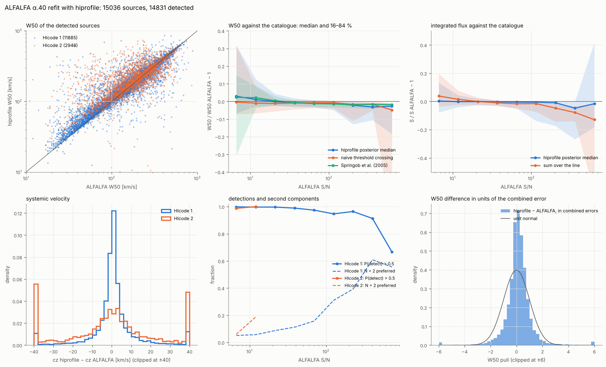
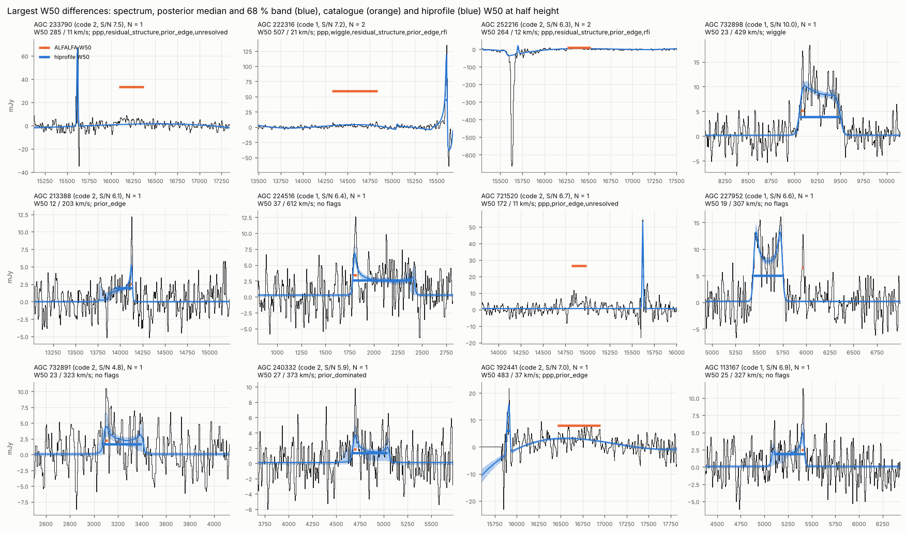

# ALFALFA α.40 refitted

All 15 041 sources with HIcode 1 or 2 of the ALFALFA α.40 catalogue
(Haynes et al. 2011) were refitted with hiprofile and compared with the
catalogue, source by source. The result is `data/alfalfa_a40.csv` (one row
per source, columns below) with `data/alfalfa_a40_summary.json`.

```bash
python benchmarks/alfalfa_survey.py fit --out DIR --n 0 --jobs 4
python benchmarks/alfalfa_survey.py compare --out DIR --catalog data/alfalfa_a40.csv --figures docs/img
```

`fit` downloads the spectra from NED (Hanning smoothed, baseline
subtracted, 5.2 km/s channels), cuts ±1000 km/s around the catalogue
velocity, and fits them with `model.response: boxcar+hanning`, N ≤ 2 and
otherwise the default configuration. Fits at 0ba7787 (median 10.6 s per
spectrum on one core, about 44 h of CPU in total), spectrum conversion at
d114eb0; the 120 spectra of the RFI follow-up below were refitted with the
current RFI defaults (symmetric outlier background, negative runs masked).
Downloads and fits resume where they stopped.

**Data preparation.** Three properties of the NED files matter:

* Blanked channels carry a flux of exactly 0 (14 % of the spectra have
  some in the window, median 22 channels); they are masked.
* `*****` marks a value that overflows its column. In the baseline column it
  is harmless, in the flux column (over 10 Jy) the channel is masked.
* Galactic HI and the high-velocity clouds reach a few hundred km/s and are
  Jy-bright; the window starts at 350 km/s. 2 sources leave fewer than 64
  usable channels and are skipped, 3 have no spectrum in NED.



## Results

15 036 spectra fitted, none failed; 14 831 detected (P(detect) > 0.5).

| ALFALFA S/N | sources | detected | W50 / catalogue − 1 | naive | Springob | S / catalogue − 1 | Δcz [km/s] |
|---|---|---|---|---|---|---|---|
| 5–6.5 | 2244 | 98.9 % | +4.7 % ± 19 % | +0.3 % ± 17 % | +1.8 % ± 22 % | +0.9 % ± 13 % | +0.4 ± 13.2 |
| 6.5–8 | 3353 | 99.8 % | +2.6 % ± 11 % | −0.5 % ± 10 % | +2.4 % ± 14 % | 0.0 % ± 8 % | +0.4 ± 7.4 |
| 8–12 | 4099 | 99.8 % | +1.5 % ± 6.5 % | −0.8 % ± 5.7 % | +2.6 % ± 6.1 % | 0.0 % ± 4.7 % | +0.6 ± 4.9 |
| 12–20 | 2407 | 99.6 % | +0.5 % ± 3.5 % | −1.1 % ± 3.7 % | +1.3 % ± 3.0 % | −0.2 % ± 2.9 % | +0.4 ± 2.9 |
| 20–50 | 1475 | 99.4 % | −0.5 % ± 2.0 % | −1.1 % ± 2.3 % | −0.4 % ± 1.6 % | −0.2 % ± 1.7 % | +0.5 ± 1.8 |
| > 50 | 501 | 96.0 % | −1.0 % ± 1.8 % | −0.9 % ± 1.7 % | −1.3 % ± 1.1 % | −0.6 % ± 1.5 % | +0.5 ± 1.4 |

Median and robust scatter over the detected sources; "naive" and
"Springob" are the classical widths that hiprofile measures on the same
spectra around the fitted component (see [validation](validation.md)).

* **Fluxes and velocities agree** with the catalogue to better than 1 % and
  1 km/s in the median at every S/N.
* **Widths** agree to about 1 % from S/N 12. Below, the posterior median is
  3–5 % wider than the catalogue, where the naive measurement on the same
  spectra is not: the shrinkage of faint lines toward the typical width of
  the prior (see the conditional-bias study in the validation).
* **Detection:** 99.6 % of the HIcode 1 and 95.1 % of the HIcode 2 sources.
  The undetected bright sources lie below cz = 350 km/s, behind the
  Galactic cut.
* **The W50 pull** (difference over the combined errors) is narrower than a
  unit normal (robust width ≈ 0.55): both measurements see the same noise,
  so their difference is smaller than independent errors would make it.
* **N = 2** is preferred for 7 % of the HIcode 1 sources, rising to most
  sources above S/N 300: bright profiles show more structure than the
  model, or a neighbour is in the window.
* **Flags:** 20.6 % of the detections; `ppp` 7.3 %, `prior_dominated`
  6.1 %, `prior_edge` 5.5 %, `wiggle` 3.5 %, `multimodal` 2.7 %,
  `residual_structure` 1.6 %, `rfi` 0.6 %.

## Disagreements

15 % of the detections differ from the catalogue W50 by more than 30 %
(10 % of HIcode 1 and 34 % of HIcode 2 above cz = 1000 km/s), 7.4 % in cz
by more than 40 km/s. 39 % of them are flagged, against 17 % of the rest.



The largest differences fall into a few groups:

* **A bright neighbour.** The catalogue source is a faint, narrow line next
  to a much brighter galaxy in the same spectrum; with N = 1 the fit
  describes the bright one (e.g. AGC 227952, 732898). These need the
  maps the ALFALFA team used; a single spectrum cannot tell which line
  belongs to the position.
* **Strong narrow spikes** that the RFI pre-stage leaves unmasked and the fit
  takes for the line (AGC 233790, 721520, 181695); mostly flagged
  `unresolved`, `ppp` or `prior_edge`.
* **Faint HIcode 2 lines** where narrow and wide solutions compete
  (`prior_dominated`, `multimodal`), and strongly lopsided profiles where
  the catalogue measures each horn at half its own height.
* **Nearby sources** (cz < 1000 km/s, 304 detections): N = 2 in 16 % and
  W50 differences above 30 % in 18 %, from the wing of Galactic HI and from
  extended, bright galaxies.

### A positive profile on a negative baseline

Every component is positive by construction (S ≥ 0, f in [0, 1],
|α| ≤ 1, positive kernels), but in 0.4 % of the detections a profile sat on
a baseline more than 5 rms below zero, so that the sum dipped below −3 rms:
the fit reproduced a dip next to strong continuum, or an RFI feature, as
"profile minus baseline". In 0.6 % a component reached the edge of the
window. The RFI pre-stage found these dips (outlier probability ≈ 1) but
kept them, because runs longer than `rfi.max_width` (20 km/s) are
protected as possible lines. That protection is now limited to runs above
the pre-stage model, and the outlier background is symmetric. On the 120
affected spectra:

| | before | now |
|---|---|---|
| profile and baseline cancel | 45 % | 21 % |
| component at the window edge | 77 % | 53 % |
| N = 2 | 73 % | 49 % |
| W50 / S / cz off by > 30 % / 30 % / 40 km/s | 53 / 60 / 51 % | 40 / 43 / 34 % |

A random sample of 500 other sources is unchanged (detected 98.2 %, W50
scatter 7.0 % instead of 7.2 %), and narrow test lines (Δv = 20–50 km/s,
S/N 5–8) lose no channel to the mask. The 5 of the 120 that are no longer
detected lie below the Galactic cut at 350 km/s: the earlier "detection" was
the wing of Galactic HI. The rest of the catalogue keeps the earlier fits;
refitting all of it with the new defaults changes the masks of about 15 % of
the spectra, mostly by one or two channels.

## Catalogue columns

`data/alfalfa_a40.csv`, widths and fluxes on the cz scale of the catalogue:

| columns | content |
|---|---|
| `agc`, `code`, `snr_cat`, `rms_cat`, `cz_cat`, `W50_cat`, `W50_cat_err`, `S_cat`, `S_cat_err` | catalogue values |
| `status`, `p_detect`, `best_n`, `best_k`, `runtime`, `flagged`, `flags` | fit summary |
| `component` | the fitted component nearest the catalogue velocity, which all values below describe |
| `cz`, `W50`, `W20`, `S` and `_p16`, `_p84` | posterior median and 68 % interval |
| `delta_v`, `delta_v_rand`, `alpha`, `f`, `constraint_delta_v` | profile parameters (medians) and how far the data narrow the Δv prior |
| `rms` | noise per channel [mJy] |
| `W50_naive`, `W20_naive`, `S_naive`, `W50_springob`, `W20_springob` | classical measurements on the same spectrum |
