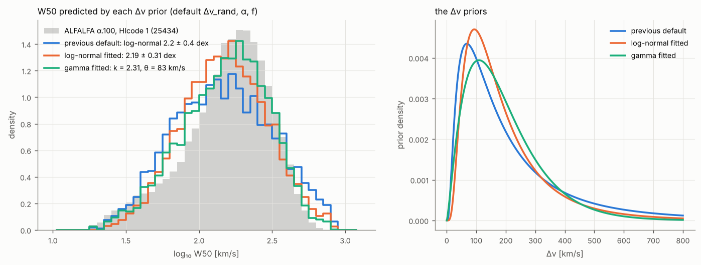

# Priors

The default priors are calibrated on the fits of the 34 THINGS galaxies in
Table 1 of Stewart, Blyth & de Blok (2014) and on the priors the authors used
for their low-S/N fits (their Appendix B.2). They are slightly wider than
THINGS because a survey contains more dwarfs, more disturbed systems and
lower S/N.

| parameter | default | THINGS fits | other references |
|---|---|---|---|
| Δv | gamma, shape 2.3, scale 83 km/s (median 166, 16–84 % 77–305 km/s), ≤ 800 km/s; fitted to the W50 of 25 434 ALFALFA detections | 0.1–566 km/s, median 153 (KS p = 0.75 against the gamma prior); two dwarfs with Δv ≈ 0 | Stewart B.2: log-normal 2.2 ± 0.3, which the log-normal fit to ALFALFA reproduces (2.19 ± 0.31) |
| Δv_rand | log-normal, log₁₀ = 1.1 ± 0.2 (≈ 12.6 km/s), 4–60 km/s | 8–32 km/s, median 12.4, log₁₀ 1.13 ± 0.16 | Stewart B.2: 1.17 ± 0.14; resolved HI dispersions ≈ 10 ± 2 km/s (Tamburro et al. 2009); narrow / broad super-profile components 6.5 ± 1.5 / 16.8 ± 4.3 km/s (Ianjamasimanana et al. 2012) |
| α | normal(0, 0.25) truncated to [−1, 1] | median 0.00, robust σ 0.14; 3 of 34 with \|α\| > 0.6 (NGC 3077, NGC 1569, Ho I) | Stewart B.2: normal(0, 0.2) |
| f | Beta(1, 3), density 3(1 − f)², median 0.21, P(f > 0.7) = 2.7 % | median 0.15, mean 0.23, 1 of 34 above 0.7 (0.93); a uniform prior is rejected (KS p < 0.001), Beta(1, 3) is not (p = 0.13) | Stewart B.2: exponentially decreasing with characteristic constant 0.3 (printed as 0.3 e^(−0.3 f), which would be nearly flat; the text describes a decreasing prior) |
| v_ctr | uniform over the positions where the whole component lies inside the band minus 5 % margins (`contain`); normal(v_cat, 20–50 km/s) for targeted spectra | – | Stewart B.2: normal, σ = 20 km/s |
| S | half-normal; scale `amplitude_scale`: `auto` = max(10 × noise of the band-integrated flux, 2 × positive band flux), i.e. noise-set near the detection threshold and flat over a bright source (a narrower prior would split bright sources into pairs); fix per survey | – | Stewart: flat (improper, unusable for evidences) |
| K | flat over `k_min` … `k_max`, coefficients N(0, `baseline_scale`²), `auto` = 10 × rms | the misspecification stage checks the K choice with a prior 50 × too wide | Stewart: order by maximum evidence |

All priors are simple one-parameter-family shapes (gamma, log-normal,
truncated normal, beta, uniform, half-normal). The flux S keeps
a half-normal prior so that it can be marginalised analytically; positivity
enters the sampling target exactly through the orthant probability (see
[Inference](inference.md)). f is a sampled parameter with its own prior: an
implicit f prior from two amplitude scales would depend on S.

**Components inside the band.** With `priors.contain` (default) every
profile component lies entirely inside the band minus the `v_margin`
margins: v_ctr ± (Δv/2 + 3 Δv_rand), which reaches about 1 % of the horn
height. The prior is built in sequence: Δv_rand and then Δv keep their
shapes and are only truncated further where no line of that width fits the
band, and v_ctr is uniform over the positions where the whole component
fits. A fixed window therefore does not favour narrow lines, and where the
band minus its margins is wider than 1160 km/s the width priors are
unchanged. Without it a
component could sit half outside the window and take up a baseline slope or
the wing of Galactic HI. Several components are labelled in the order of
their relative position in that allowed range (not strictly of v_ctr). A
posterior pressed against the limit (`edge_band_<i>`) raises `prior_edge`:
the line is probably cut by the window. Containment needs a uniform v_ctr
prior; an explicit range `v_ctr: {low, high}` stays the range of the
centre.

**Rotational width.** W50 mixes the rotational width Δv with the random
motions, the asymmetry and the solid-body fraction, so Δv cannot be read off
a W50 histogram. `benchmarks/fit_width_prior.py` forward-models it instead:
it draws profiles with Δv from a candidate prior and Δv_rand, α, f from the
defaults, computes their W50 with the model and fits the candidate's
parameters to the quantiles of the observed log W50. On the 25 434 HIcode 1
detections of ALFALFA α.100 (rest-frame W50, median 170 km/s, 0.29 dex,
skewed towards narrow lines):

| Δv prior | quantile misfit | KS distance |
|---|---|---|
| previous default, log-normal 2.2 ± 0.4 dex | 0.079 dex | 0.106 |
| log-normal fitted, 2.19 ± 0.31 dex | 0.058 dex | 0.077 |
| log-normal × sin i (isotropic inclinations), 2.32 ± 0.27 dex | 0.045 dex | 0.060 |
| **gamma fitted, k = 2.3, θ = 83 km/s** | **0.033 dex** | **0.043** |
| gamma × sin i, k = 3.3, θ = 74 km/s | 0.031 dex | 0.038 |

The gamma is skewed towards small widths in log Δv like the data and falls
off exponentially above 300 km/s like the velocity function of massive
galaxies; projecting it with random inclinations hardly improves the fit
and is left out. The previous 0.4 dex were a setting without data and
predicted far too many very wide lines. The calibration describes the
detected population of a flux-limited single-dish survey out to
cz ≈ 18 000 km/s; deeper or interferometric surveys (WALLABY, FAST) select
differently and should run the script on their own W50 catalogue
(`--catalog FILE --w50-column ...`). The gamma density vanishes like
Δv^1.3 towards Δv = 0: face-on or dispersion-dominated dwarfs get their
width through Δv_rand, which leaves W50 right but makes the split between
Δv and Δv_rand a prior statement (`prior_dominated`).

**Solid-body fraction.** f is the fraction of the HI inside the radius where
the rotation curve turns over. In spirals that radius is small compared with
the HI disk, so most of the gas sits on the flat part and f is small; only
dwarfs whose rotation curve rises across the whole disk approach f ≈ 1. A
uniform prior gave such solid-body profiles 30 % of the prior mass, and at
low S/N, where the data barely constrain f, it pulled posterior medians to
0.5–0.8 even for 350 km/s wide lines. Beta(1, 3) follows the THINGS
distribution and keeps f > 0.7 possible (2.7 %) but rare. Physics also says
that f should fall with galaxy mass, but the THINGS fits show only a weak
trend with Δv (Spearman r = −0.22, p = 0.22), and Δv is V_rot sin i, so a
prior on f conditional on Δv would also penalise face-on spirals; f keeps a
single prior.

The simulator draws from the same priors (`hiprofile simulate`, all
validation stages), so simulated galaxies look like the ones the fit expects.

## Survey-specific settings

* **Single-dish surveys** (HIPASS, ALFALFA, EBHIS, FAST): standing waves need
  higher baseline orders; Stewart et al. needed K = 6 for EBHIS. Use
  `model.k_max: 6` and a baseline prior from signal-free neighbour spectra
  (`hiprofile.likelihood.baseline.baseline_prior_from_spectra`).
* **Interferometric surveys** (WALLABY, THINGS-like cubes): K ≤ 1 is usually
  enough.
* **Targeted spectra** with an optical redshift: `priors.v_ctr: {kind: normal,
  mean: <v_cat>, std: 30}`.
* **Evidence comparisons across a survey**: set `priors.amplitude_scale` to a
  fixed value (e.g. the 95th percentile of the expected integrated fluxes).

At high S/N the data dominate and the priors hardly matter; at low S/N they
regularise the degeneracy between Δv and Δv_rand. Objects outside the THINGS
range (very disturbed or very narrow profiles) are pulled towards typical
values; the `prior_edge` flag marks posteriors that pile up at a prior
boundary, and `prior_dominated` marks fits whose Δv posterior is not much
narrower than the prior (the width is then a prior statement, not a
measurement). The bias study in [Validation](validation.md#conditional-bias-default-against-flat-priors)
measures the pull for fixed true profiles: from S/N 8 upwards the posterior
median of W50 is unbiased to within 11 km/s; at S/N 5 a 430 km/s line
is pulled down by 22 km/s with these priors and by 137 km/s with flat
(log-uniform) priors, so the THINGS priors are kept as defaults.

References: Stewart, Blyth & de Blok (2014), A&A 567, A61 (arXiv:1405.1838);
Ianjamasimanana et al. (2012), arXiv:1207.5041; Oman (2022), arXiv:2108.08856;
Tamburro et al. (2009), AJ.
