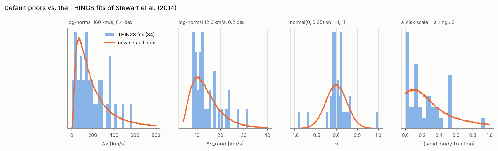

# Priors

The default priors are calibrated on the fits of the 34 THINGS galaxies in
Table 1 of Stewart, Blyth & de Blok (2014) and on the priors the authors used
for their low-S/N fits (their Appendix B.2). They are slightly wider than
THINGS because a survey contains more dwarfs, more disturbed systems and
lower S/N.

| parameter | default | THINGS fits | other references |
|---|---|---|---|
| Δv | log-normal, log₁₀ = 2.2 ± 0.4 (≈ 160 km/s), ≤ 800 km/s | 0.1–566 km/s, median 153; two dwarfs with Δv ≈ 0 | Stewart B.2: log-normal 2.2 ± 0.3; ALFALFA width function: modified Schechter with w* ≈ 300 km/s, α ≈ −0.56 (Oman 2022) |
| Δv_rand | log-normal, log₁₀ = 1.1 ± 0.2 (≈ 12.6 km/s), 4–60 km/s | 8–32 km/s, median 12.4, log₁₀ 1.13 ± 0.16 | Stewart B.2: 1.17 ± 0.14; resolved HI dispersions ≈ 10 ± 2 km/s (Tamburro et al. 2009); narrow / broad super-profile components 6.5 ± 1.5 / 16.8 ± 4.3 km/s (Ianjamasimanana et al. 2012) |
| α | normal(0, 0.25) truncated to [−1, 1] | median 0.00, robust σ 0.14; 3 of 34 with \|α\| > 0.6 (NGC 3077, NGC 1569, Ho I) | Stewart B.2: normal(0, 0.2) |
| f | Beta(1, 3), density 3(1 − f)², median 0.21, P(f > 0.7) = 2.7 % | median 0.15, mean 0.23, 1 of 34 above 0.7 (0.93); a uniform prior is rejected (KS p < 0.001), Beta(1, 3) is not (p = 0.13) | Stewart B.2: exponentially decreasing with characteristic constant 0.3 (printed as 0.3 e^(−0.3 f), which would be nearly flat; the text describes a decreasing prior) |
| v_ctr | uniform over the band minus 5 % margins; normal(v_cat, 20–50 km/s) for targeted spectra | – | Stewart B.2: normal, σ = 20 km/s |
| S | half-normal; scale `amplitude_scale`: `auto` = max(10 × noise of the band-integrated flux, 2 × positive band flux), i.e. noise-set near the detection threshold and flat over a bright source (a narrower prior would split bright sources into pairs); fix per survey | – | Stewart: flat (improper, unusable for evidences) |
| K | flat over `k_min` … `k_max`, coefficients N(0, `baseline_scale`²), `auto` = 10 × rms | the misspecification stage checks the K choice with a prior 50 × too wide | Stewart: order by maximum evidence |

All priors are simple one-parameter-family shapes (log-normal, truncated
normal, beta, uniform, half-normal); Δv uses 0.4 dex instead of the 0.3 dex of
Stewart et al. so that narrow dwarf profiles keep prior mass. The flux S keeps
a half-normal prior so that it can be marginalised analytically; positivity
enters the sampling target exactly through the orthant probability (see
[Inference](inference.md)). f is a sampled parameter with its own prior: an
implicit f prior from two amplitude scales would depend on S.

**Solid-body fraction.** f is the fraction of the HI inside the radius where
the rotation curve turns over. In spirals that radius is small compared with
the HI disk, so most of the gas sits on the flat part and f is small; only
dwarfs whose rotation curve rises across the whole disk approach f ≈ 1. A
uniform prior gave such solid-body profiles 30 % of the prior mass, and at
low S/N, where the data barely constrain f, it pulled posterior medians to
0.5–0.8 even for 350 km/s wide lines. Beta(1, 3) follows the THINGS
distribution and keeps f > 0.7 possible (2.7 %) but rare. Physics also says
that f should fall with galaxy mass, but the THINGS fits show only a weak
trend with Δv (Spearman r = −0.22, p = 0.22), and Δv is V_rot sin i, so a
prior on f conditional on Δv would also penalise face-on spirals; f keeps a
single prior.

The simulator draws from the same priors (`hiprofile simulate`, all
validation stages), so simulated galaxies look like the ones the fit expects.

## Survey-specific settings

* **Single-dish surveys** (HIPASS, ALFALFA, EBHIS, FAST): standing waves need
  higher baseline orders; Stewart et al. needed K = 6 for EBHIS. Use
  `model.k_max: 6` and a baseline prior from signal-free neighbour spectra
  (`hiprofile.likelihood.baseline.baseline_prior_from_spectra`).
* **Interferometric surveys** (WALLABY, THINGS-like cubes): K ≤ 1 is usually
  enough.
* **Targeted spectra** with an optical redshift: `priors.v_ctr: {kind: normal,
  mean: <v_cat>, std: 30}`.
* **Evidence comparisons across a survey**: set `priors.amplitude_scale` to a
  fixed value (e.g. the 95th percentile of the expected integrated fluxes).

At high S/N the data dominate and the priors hardly matter; at low S/N they
regularise the degeneracy between Δv and Δv_rand. Objects outside the THINGS
range (very disturbed or very narrow profiles) are pulled towards typical
values; the `prior_edge` flag marks posteriors that pile up at a prior
boundary, and `prior_dominated` marks fits whose Δv posterior is not much
narrower than the prior (the width is then a prior statement, not a
measurement). The bias study in [Validation](validation.md#conditional-bias-default-against-flat-priors)
measures the pull for fixed true profiles: from S/N 8 upwards the posterior
median of W50 is unbiased to within about 10 km/s; at S/N 5 a 430 km/s line
is pulled down by 20 km/s with these priors and by 130 km/s with flat
(log-uniform) priors, so the THINGS priors are kept as defaults.

References: Stewart, Blyth & de Blok (2014), A&A 567, A61 (arXiv:1405.1838);
Ianjamasimanana et al. (2012), arXiv:1207.5041; Oman (2022), arXiv:2108.08856;
Tamburro et al. (2009), AJ.
