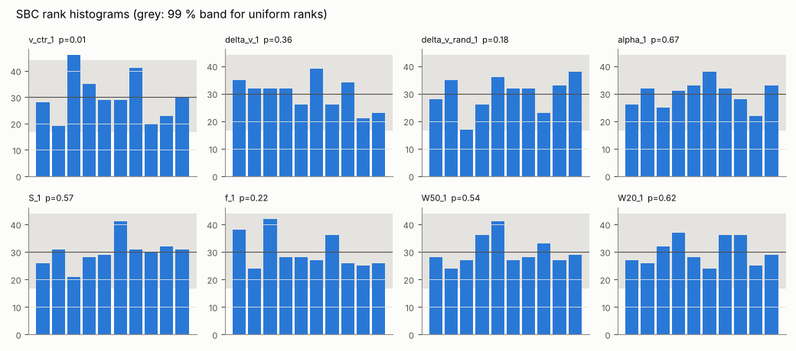

# Validation

All runs are reproducible with `hiprofile validate` (setup of each stage in
`hiprofile/validate/stages.py`). Results below come from runs on a 4-core
machine and cover fewer simulations than the roadmap's acceptance targets
(1000 SBC simulations); the nightly CI job adds a small SBC run each night.

## Stage 1: simulation-based calibration

`hiprofile validate --stage sbc --n 300 --seed 11 --jobs 3` (full mode,
nautilus). Parameters, amplitudes (half-normal, scale 4 Jy km/s) and a
first-order Chebyshev baseline are drawn from the fit prior. Noise is white
with σ = 0.01, on 512 channels of 5 km/s.

| parameter | rank p-value | 68 % coverage | 95 % coverage |
|---|---|---|---|
| v_ctr | 0.007 | 0.71 | 0.93 |
| Δv | 0.36 | 0.68 | 0.94 |
| Δv_rand | 0.18 | 0.65 | 0.92 |
| α | 0.67 | 0.66 | 0.94 |
| S | 0.57 | 0.68 | 0.92 |
| f | 0.23 | 0.67 | 0.94 |
| W50 | 0.54 | 0.70 | 0.95 |
| W20 | 0.62 | 0.70 | 0.92 |

All 68 % coverages lie within or at the edge of the 65–71 % target. The
v_ctr rank histogram has no systematic shape (no U, slope or peak). With eight
tests its p = 0.007 corresponds to 0.056 after a Bonferroni correction. A
1000-simulation run is still needed to close the acceptance criterion.

The same simulations measured against the truth:

| quantity | Bayes bias | Bayes scatter | classical bias | classical scatter |
|---|---|---|---|---|
| W50 [km/s] | 0.3 | 15.5 | 12.5 | 41.1 |
| W20 [km/s] | −0.1 | 17.4 | 43.4 | 60.8 |
| S [Jy km/s] | −0.04 | 0.47 | −0.14 | 0.53 |
| v_sys [km/s] | 0.01 | 7.6 | 0.29 | 18.5 |

Compared with the classical measurement, the posterior medians are unbiased
and their scatter is 2.5–3.5 times smaller for W50, W20 and v_sys.

One simulation (S/N ≈ 3.5) needed 0.5–0.7 million likelihood calls in every
nested sampler, although all of them agreed on ln Z to within 0.5. The
samplers now have time and call budgets, and the `sampler_budget` flag
marks a fit that hit one.

Example posterior (corner plot of a low-S/N SBC spectrum with a bimodal centre):

