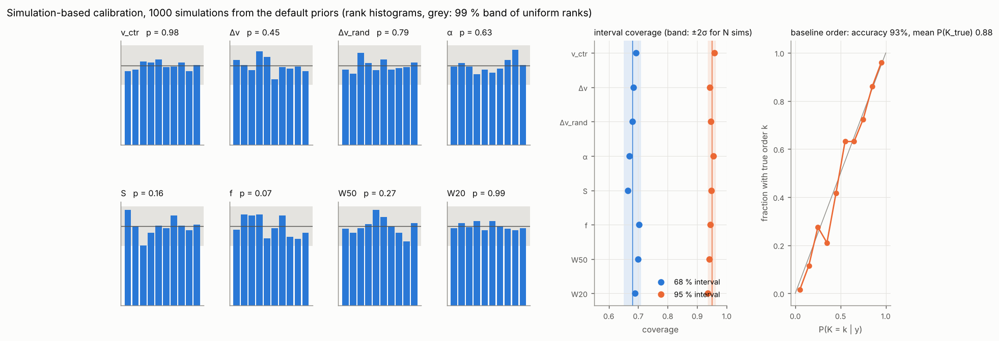
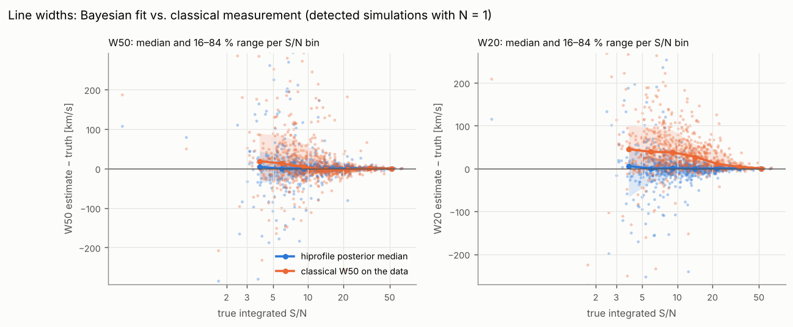
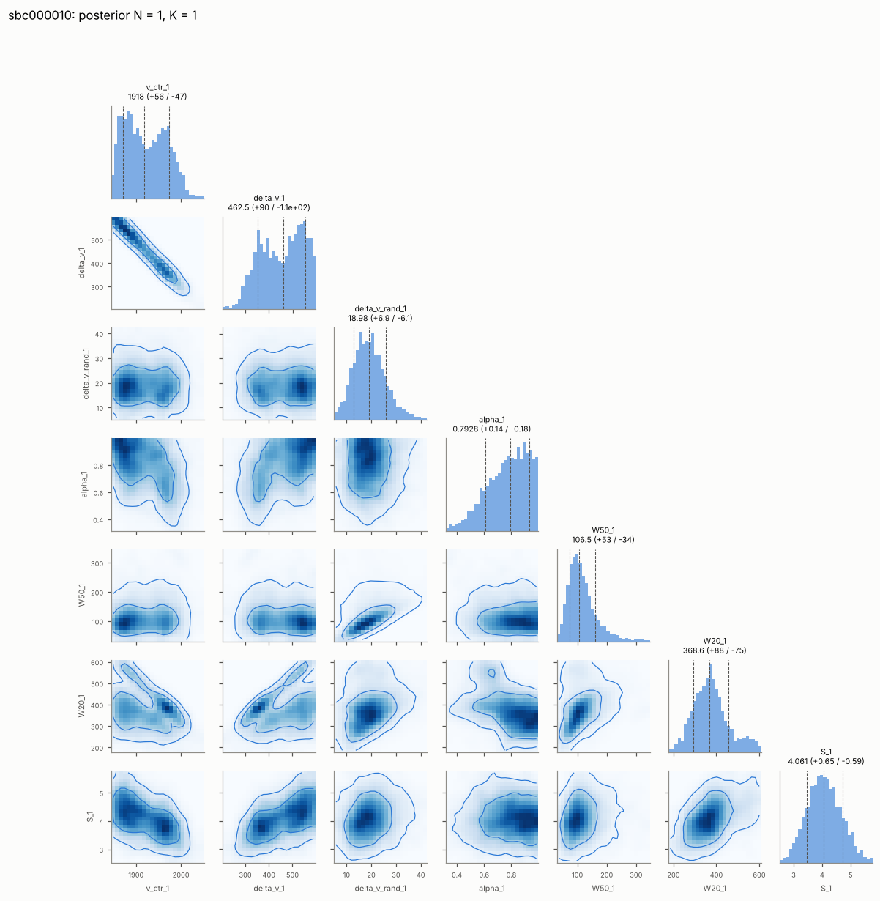

# Validation

All stages run with `hiprofile validate` (set-up of each stage in
`hiprofile/validate/stages.py`); the figures come from
`python docs/make_figures.py validation <run directory>`. The results below
use the default configuration (full mode, SMC sampler, N ≤ 2, K ≤ 3, RFI
pre-stage) on a 4-core machine: `--seed 11` for the 1000 SBC simulations,
`--seed 21` for the 200 detection simulations and `--seed 31` for the 100
misspecified profiles.

## Stage 1: simulation-based calibration

`hiprofile validate --stage sbc --n 1000 --seed 11 --jobs 4`

Every simulation is drawn from the fit priors: the five shape parameters,
the flux (half-normal with the default `amplitude_scale`), and a Chebyshev
baseline of order K ~ U{0, …, 3} with coefficients from the baseline prior;
white noise with σ = 0.01 Jy on 512 channels of 5 km/s. The fit uses the same
priors with the order marginalised (`k_min = 0`, `k_max = 3`). The rank of
the truth among 99 posterior draws must then be uniform, and the posterior
intervals must cover the truth at their nominal rate.

| parameter | rank p-value | 68 % coverage | 95 % coverage |
|---|---|---|---|
| v_ctr | 0.98 | 0.69 | 0.96 |
| Δv | 0.45 | 0.68 | 0.94 |
| Δv_rand | 0.79 | 0.68 | 0.95 |
| α | 0.63 | 0.67 | 0.96 |
| S | 0.16 | 0.67 | 0.95 |
| f | 0.07 | 0.70 | 0.94 |
| W50 | 0.27 | 0.70 | 0.94 |
| W20 | 0.99 | 0.69 | 0.94 |



All rank histograms are flat (no U shape, slope or peak; all p > 0.05), and
the 68 % and 95 % coverages lie inside the ±2σ bands for 1000 simulations
(0.65–0.71 and 0.94–0.96). The 27.6 % of simulations that are not detected
(faint draws of the half-normal flux prior) take part in the rank
statistics like every other simulation.

**Baseline order.** The most probable K is the true one in 93 % of the
simulations and P(K_true | y) averages 0.88; the reliability curve (right
panel) follows the diagonal, so the order probabilities in the catalogue
mean what they say. The confusion matrix (rows: true K, columns: most
probable K) is one-sided:

```
  266      2      0      0
   14    229      0      0
    6     14    220      0
    2      6     26    215
```

A true K = 3 whose highest coefficients happen to be small is read as K = 2
(26 of 249), which is the right answer for terms the data cannot see; the
reverse, a spurious high order, almost never happens.

**Flags.** 12 % of the fits carry a flag: `prior_edge` 6.4 % (Δv_rand at
its 4 km/s bound or f at 0/1 for faint, narrow lines), `prior_dominated`
3.8 %, `wiggle` 2.1 %, `multimodal` 0.9 %, `ppp` 0.9 %. None of these
rates is a failure: the simulations include the faint end of the flux prior,
where the width is not measurable.

The same simulations measured against the truth (detected ones, N = 1):

| quantity | Bayes bias | Bayes scatter | classical bias | classical scatter |
|---|---|---|---|---|
| W50 [km/s] | 0.4 | 10.6 | −0.3 | 19.5 |
| W20 [km/s] | 0.4 | 13.0 | 23.5 | 33.5 |
| S [Jy km/s] | 0.000 | 0.36 | 0.03 | 0.39 |
| v_sys [km/s] | −0.2 | 4.5 | 0.1 | 8.3 |



The posterior medians are unbiased, and their scatter is half (W50, v_sys)
to a third (W20) of that of the classical measurement on the same data. The
classical W20 is biased high at low S/N because noise peaks raise the 20 %
crossing points; the Bayesian W50 is pulled slightly low below S/N ≈ 4,
where the width prior takes over (`prior_dominated`). See
[Priors](priors.md) for the conditional bias as a function of true width
and S/N.

Example posterior (corner plot of a low-S/N SBC spectrum with a bimodal
centre):


