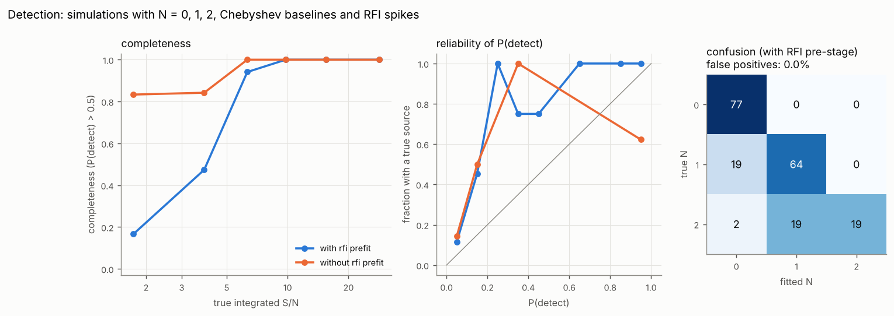
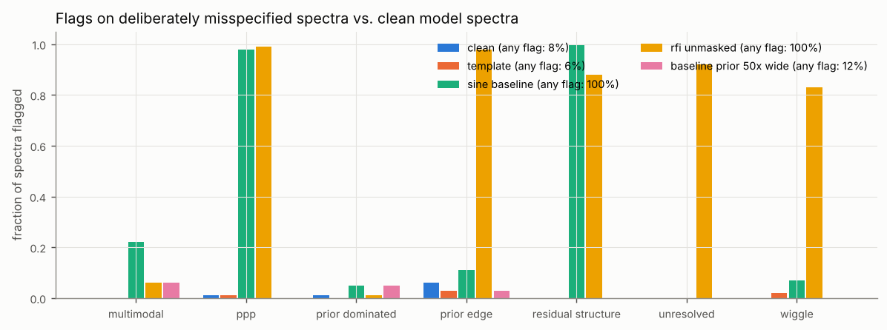
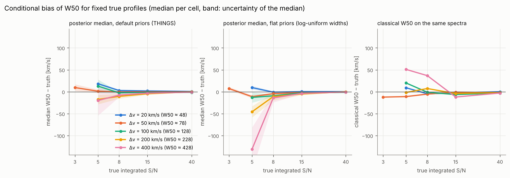
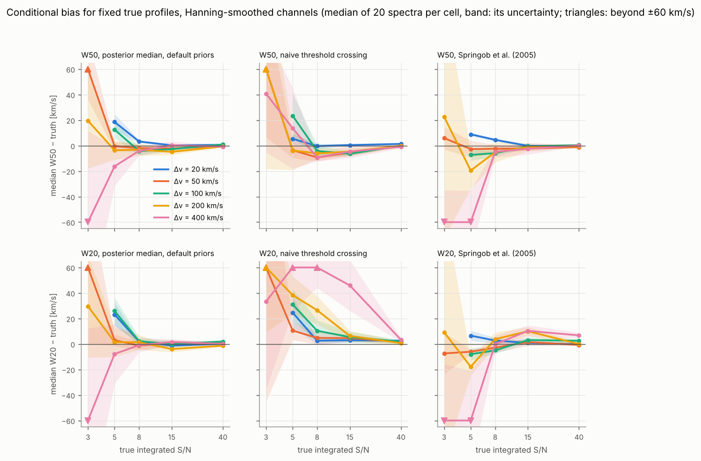
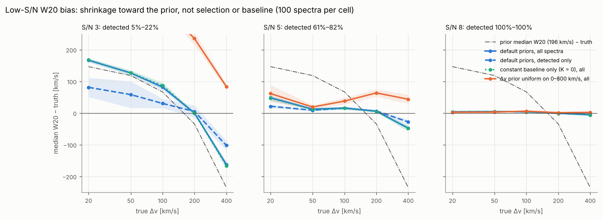
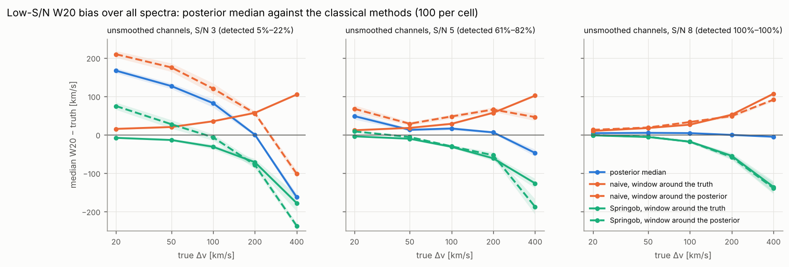
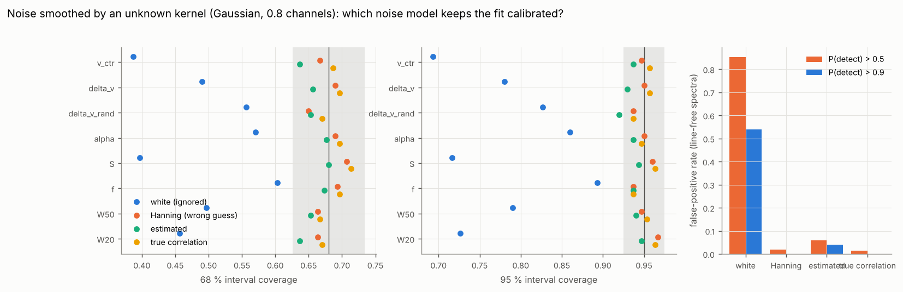
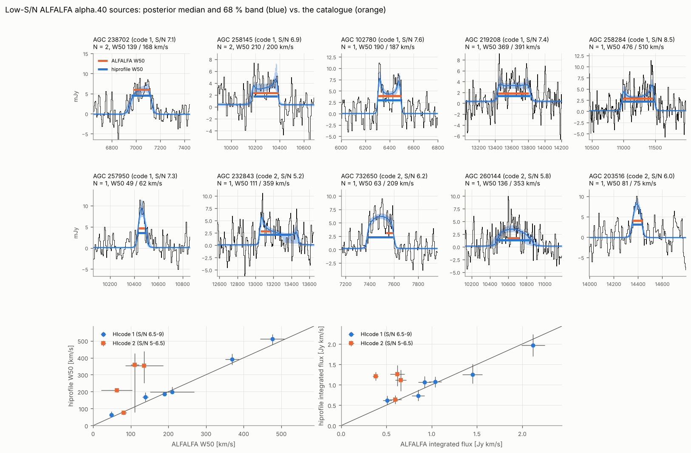

# Validation

Everything on this page comes from runs of `benchmarks/validate_all.sh` on
a 4-core machine with the default configuration (full mode, SMC sampler,
N ≤ 2, K ≤ 3, RFI pre-stage, Δv ~ Gamma(2.3, 83 km/s), f ~ Beta(1, 3)),
5 km/s channels unless stated otherwise. SBC, detection and
misspecification were refitted at 0ba7787, after two fixes found on bright
ALFALFA spectra (the orthant probability of two amplitudes far in the tail,
8433605) and with the `residual_structure` flag; the SBC came out
identical apart from the flags. The bias and ALFALFA fits were made at
commit 2724f8a (the Δv prior), and later commits only add the Springob
et al. (2005) widths, which
`benchmarks/add_springob.py` computed from the stored spectra and
baselines (the naive values are reproduced exactly), and the Hanning bias
run. The low-S/N bias decomposition (`benchmarks/w20_bias.py`) ran at
b0f5c72, the same fitting code. The correlated-noise study is from 61a2b05 with the earlier
log-normal Δv prior; it tests the noise model, which the prior does not
touch.

**Classical references.** Every stage measures the widths in two classical
ways on the same baseline-subtracted spectra, in a window of ±(W20/2 + 25 %
+ 2 channels) around the posterior v_sys, as a by-eye window would be
chosen:

* *naive*: outermost channels above 50 % / 20 % of the peak channel,
  interpolated linearly to the next channel outward;
* *Springob et al. (2005)* W_F50, as used for the ALFALFA catalogue widths:
  per horn, a straight line fitted to the flank between the first channels
  below 85 % and 15 % of (horn − rms), read at 50 %; for Hanning-smoothed
  spectra minus their instrumental correction 2 Δv_chan λ(S/N). Read at
  20 % of the same lines it gives a W20, which is our extension of the
  method (λ is calibrated for W_F50 only). Where a flank cannot be fitted
  (fit rising away from the horn, crossing outside the window) it gives no
  value; that happens for 14 % of the detected SBC lines, nearly all at
  S/N < 8.

| stage | command | spectra |
|---|---|---|
| SBC | `hiprofile validate --stage sbc --n 1000 --seed 11` | 1000 |
| detection | `hiprofile validate --stage detection --n 200 --seed 21` | 200, fitted twice |
| misspecification | `hiprofile validate --stage misspec --n 100 --seed 31` | 5 × 100 |
| conditional bias | `python benchmarks/bias_study.py --n 20 --priors default\|flat`, and `--response boxcar+hanning` | 3 × 500 |
| low-S/N bias causes | `python benchmarks/w20_bias.py --n 100`, and `--variants default --response boxcar+hanning` | 1500, fitted three times; 1500 Hanning |
| correlated noise | `python benchmarks/correlated_noise.py --n 300 --n-noise 150` | 450, fitted four times |
| real data | `python benchmarks/alfalfa_study.py` | 10 ALFALFA sources |

## Stage 1: simulation-based calibration

Every simulation is drawn from the fit priors: the five shape parameters,
the flux (half-normal, scale 4 Jy km/s) and a Chebyshev baseline of order
K ~ U{0, …, 3} with coefficients from the baseline prior; white noise with
σ = 0.01 Jy on 512 channels. The fit uses the same priors with the order
marginalised. The rank of the truth among 99 posterior draws must then be
uniform, and the posterior intervals must cover the truth at their nominal
rate.

| parameter | rank p-value | 68 % coverage | 95 % coverage |
|---|---|---|---|
| v_ctr | 0.79 | 0.68 | 0.96 |
| Δv | 0.54 | 0.69 | 0.94 |
| Δv_rand | 0.03 | 0.69 | 0.95 |
| α | 0.18 | 0.67 | 0.95 |
| S | 0.21 | 0.68 | 0.95 |
| f | 0.48 | 0.70 | 0.94 |
| W50 | 0.10 | 0.70 | 0.94 |
| W20 | 0.96 | 0.68 | 0.93 |


The 68 % coverages lie inside the ±2σ band for 1000 simulations
(0.65–0.71), the 95 % coverages inside theirs (0.936–0.964) except W20 at
0.932. Seven of eight rank histograms are flat (p ≥ 0.1); the Δv_rand
histogram has p = 0.03 (counts 82, 97, 88, 130, 100, 116, 88, 95, 98, 106
in ten bins), one high bin without a slope or U shape. With eight tests, one
p below 0.05 turns up by chance in a third of all runs. With
the previous log-normal Δv prior the same test gave p = 0.39. The faint
draws of the flux prior that are not detected take part like every other
simulation.

**Baseline order.** The most probable K is the true one in 93 % of the
simulations and P(K_true | y) averages 0.88; the reliability curve (right
panel) follows the diagonal. The confusion matrix (rows: true K, columns:
most probable K) is one-sided:

```
  266      2      0      0
   14    229      0      0
    5     13    222      0
    2      6     25    216
```

A true K = 3 whose highest coefficients happen to be small is read as K = 2,
the right answer for terms the data cannot see. This calibration holds when
the baseline prior matches the baselines; Stage 3 shows what happens when
it does not.

**Flags.** 12.2 % of the fits carry a flag: `prior_edge` 5.5 % (Δv_rand at
its 4 km/s bound for faint, narrow lines), `prior_dominated` 3.4 %,
`wiggle` 2.1 %, `multimodal` 1.3 %, `ppp` 1.1 %, `residual_structure` 0.1 % (its
calibrated false-alarm rate).

The same simulations measured against the truth (726 detected, N = 1;
median error and robust scatter):

| quantity | Bayes | naive | Springob |
|---|---|---|---|
| W50 [km/s] | 0.4 ± 10.6 | 0.3 ± 22.2 | −7.5 ± 22.6 (624 measured) |
| W20 [km/s] | 0.4 ± 12.6 | 27.7 ± 35.5 | −10.1 ± 32.8 |
| S [Jy km/s] | 0.01 ± 0.36 | 0.04 ± 0.39 | – |
| v_sys [km/s] | 0.0 ± 4.8 | 0.1 ± 9.0 | 0.4 ± 9.3 |


The posterior medians are unbiased with half the scatter of either
classical width. Each classical method fails in its own way at low S/N:
noise peaks above the 20 % threshold make the naive W20 too wide, and in
these unsmoothed 5 km/s channels a noise dip next to a horn ends the
Springob flank search early, so its widths come out too narrow below
S/N ≈ 15. Above S/N ≈ 25 all three agree (figure). The SBC population is
drawn from the prior with unsmoothed channels; for Hanning-smoothed
spectra, where Springob's method is at home, see the bias study below.

Example posterior (corner plot of a low-S/N spectrum with a bimodal centre):


## Stage 2: detection and confusion

200 spectra with N = 0, 1, 2 (probabilities 0.4, 0.4, 0.2), integrated S/N
2–40 per component, a first-order baseline and single-channel RFI spikes
(2–3 per spectrum), fitted with and without the RFI pre-stage and the
automatic flux-prior scale.



| | with RFI pre-stage | without |
|---|---|---|
| false positives, P(detect) > 0.5 / 0.9 | 0 of 77 / 0 | 83 % / 83 % |
| completeness S/N 3–5 / 5–8 / ≥ 8 | 0.55 / 0.94 / 1.00 | 0.90 / 1.00 / 1.00 |
| flagged | 5.5 % | 87 % |

Confusion matrix with the pre-stage (rows: true N, columns: most probable N):

```
   77      0      0
   19     64      0
    2     19     19
```

* **N = 0 and N = 1** are separated cleanly: no false positive at any
  threshold, and no single line split into two. Without the pre-stage the
  RFI spikes are fitted as lines (83 % false positives, 64 % flagged
  `unresolved`, 48 % `residual_structure`); its higher "completeness" is
  the same effect.
* **The completeness** at S/N 3–5 is that of the SBC, which has no RFI, so
  the pre-stage costs none.
* **N = 2.** Of the 18 pairs with both components at S/N > 6 and separated
  by more than their width, 15 are fitted as N = 2. Pairs with a second
  component below S/N 6 (21 of 40) are mostly fitted as N = 1: a second line
  at S/N 3 is not detectable on its own either.
* Widths of the detected single lines (bias ± scatter, km/s): W50
  0.2 ± 8.5 (naive −1.9 ± 11.9, Springob −1.0 ± 13.8), W20 0.4 ± 9.4
  (naive 26.3 ± 35.3, Springob 0.6 ± 12.8).

## Stage 3: misspecification

Five sets of 100 one-component spectra at S/N 5–80: model profiles
(`clean`); profiles the model does not generate (`template`: tilted-ring
galaxies with a rising rotation curve, inclinations 30–85°, lopsidedness up
to 30 % and central HI holes, integrated on a fine grid); model profiles on
a sinusoidal baseline that no Chebyshev polynomial up to K = 3 describes;
model profiles with RFI and no pre-stage; and Chebyshev baselines of order
0–3 whose coefficients are 50 times smaller than the fit's automatic prior
scale.



| set | flagged | W50 bias / scatter [km/s] | 68 % coverage of W50 | W50 scatter naive / Springob | W20 bias / scatter: Bayes, naive, Springob |
|---|---|---|---|---|---|
| clean | 7 % | 0.6 / 4.7 | 0.75 | 11.4 / 8.3 | 1.2 / 4.4, 14.5 / 23.7, 3.5 / 6.8 |
| template | 4 % | −1.5 / 6.9 | 0.69 | 9.4 / 11.4 | −0.4 / 7.7, 8.2 / 20.7, −1.1 / 12.7 |
| sine baseline | 100 % | −0.7 / 24.7 | 0.35 | 25.9 / 25.0 | −1.0 / 24.6, 7.0 / 52.7, −0.4 / 35.8 |
| RFI unmasked | 100 % | −104 / 110 | 0.16 | 106 / 77 | −106 / 128, −142 / 127, −39 / 67 |
| baseline prior 50 × too wide | 8 % | 0.7 / 4.7 | 0.70 | 13.3 / 8.0 | 0.3 / 7.2, 26.1 / 38.2, 1.1 / 13.5 |

* The model describes the galaxy-like templates well enough that the widths
  stay unbiased and calibrated, with less scatter than either classical
  method, which see the same profiles.
* When the model is wrong the posteriors are overconfident, as any
  posterior of a wrong model is, but the flags catch it:
  `residual_structure` marks every sine-baseline fit and `ppp` 96 % of
  them; `ppp`, `prior_edge`, `unresolved`, `residual_structure` (89 %) and
  `wiggle` mark the RFI fits. Unmasked RFI hurts the
  Springob widths least, because a spike rarely lies on a flank; it is
  still the flagged fits that tell the user something is wrong.
* **A wrong baseline prior** leaves the line parameters unbiased and
  calibrated, but not the baseline order: the most probable K is right in
  42 % of the spectra, nearly always too low (22 of 28 true K = 3 are fitted
  as K = 0). Coefficients of 0.2 σ per channel are barely visible, and with
  a prior 50 times too wide the Occam factor wins. The `p_k` columns of the
  catalogue are calibrated only with a fitting `priors.baseline_scale`, for
  example from signal-free neighbour spectra
  (`hiprofile.likelihood.baseline.baseline_prior_from_spectra`).

## Conditional bias: priors and classical methods

The SBC shows that the posteriors are calibrated *on average over the
prior*. For a given galaxy the posterior median is still pulled towards
typical values when the data are weak. The bias study fixes the true
profile on a grid of widths (Δv = 20–400 km/s, Δv_rand = 12 km/s, α = 0.1,
f = 0.25) and integrated S/N (3–40), simulates 20 spectra per cell and fits
them with the default priors and with flat priors (log-uniform Δv and
Δv_rand, uniform α and f). A third run repeats the default-prior case with
Hanning-smoothed spectra (the line and white noise smoothed alike, so the
integrated S/N is unchanged and the channel rms drops to 0.61 of it), fitted
with `model.response: boxcar+hanning`; that is how ALFALFA and most
single-dish spectra are delivered, and where Springob's correction applies.
Medians are over the spectra the fit detects (P(detect) > 0.5).





Largest |median error| over the widths, in km/s (in brackets: median of
the per-cell scatter):

| channels | S/N | W50 Bayes | W50 naive | W50 Springob | W20 Bayes | W20 naive | W20 Springob |
|---|---|---|---|---|---|---|---|
| unsmoothed | 5 | 31 (29) | 36 (53) | 141 (27) | 29 (31) | 69 (36) | 153 (39) |
| unsmoothed | 8–40 | 10 (5) | 31 (7) | 136 (7) | 5 (7) | 103 (13) | 135 (7) |
| unsmoothed | 15–40 | 4 (4) | 12 (5) | 9 (4) | 2 (5) | 82 (11) | 10 (6) |
| Hanning | 5 | 19 (23) | 23 (49) | 167 (19) | 26 (37) | 94 (43) | 155 (16) |
| Hanning | 8–40 | 5 (5) | 9 (7) | 6 (5) ¹ | 4 (8) | 63 (10) | 10 (8) ¹ |

¹ From 20 spectra per cell; with 100 spectra the Springob widths of
400 km/s lines at S/N 8 are −89 km/s (W50) and −81 km/s (W20) off in the
median (see below), so this entry holds from S/N 15 only.

* **From S/N 8 upwards** the posterior median with the default priors is
  unbiased to within 11 km/s in W50 and 5 km/s in W20 for every width, on
  either kind of channel.
* **Springob et al. (2005)** is as good as the fit for W50 on Hanning-smoothed
  spectra from S/N 15 (bias ≤ 3 km/s, the same scatter), and at S/N 8 for
  lines up to Δv = 100 km/s. For wider lines at S/N 8 the 20 spectra per
  cell of this study are too few: with 100 (next section) the Springob W50
  of 400 km/s lines is 89 km/s too narrow in the median, by more than
  50 km/s in 64 % of the spectra, where the fit is off by −10 km/s. On
  unsmoothed channels and at S/N 5 it fails for wide lines (−70 to
  −170 km/s). The per-channel S/N of a 400 km/s line at integrated S/N 8
  is about 1, and the first noise dip below 15 % of the horn ends the flank
  fit inside the profile.
* **The naive threshold crossing** is fine for W50 but not for W20: noise
  peaks above 20 % of the peak channel widen it by up to 100 km/s for wide
  lines, still +46 km/s at S/N 15 with Hanning smoothing.
* **At S/N 5** the default priors pull a 400 km/s line down by 31 km/s and
  20–100 km/s lines up by up to 20 km/s (unsmoothed; 16 and 19 km/s with
  Hanning). The flat priors pull the wide line down by 137 km/s and a
  200 km/s line by 42 km/s. A flat prior is therefore *not* the unbiased
  choice: the log-uniform width prior puts most of its mass at small
  widths, and the faint wings of a wide line are lost in the noise and the
  baseline whatever the prior.
* **Selection.** At S/N 5 only about half of the 20 km/s lines are
  detected (45 %, 60 % with Hanning), and those that are are the ones whose
  noise made them look brighter and wider: their W20 is 23–29 km/s too wide,
  and the 68 % interval of W20 covers the truth in 11 % (42 % with Hanning)
  of them. This is a property of the detected subsample, not of the
  posterior: over all simulations the SBC coverages hold. The
  `prior_dominated` flag marks up to half of the fits at S/N 5 (the
  400 km/s lines); the width of a line at S/N ≤ 5 is largely a statement of
  the prior, not a measurement.

### Where the low-S/N bias comes from

`benchmarks/w20_bias.py` refits the cells at S/N 3, 5 and 8 with 100
spectra each (unsmoothed channels unless stated otherwise, no baseline in the data) three times:
with the default configuration, with only a constant baseline (K = 0), and
with a Δv prior uniform on 0–800 km/s. Medians are taken over all spectra
(the N = 1 posterior exists for every spectrum), over the detected and over
the undetected ones, with bootstrap errors.



| Δv, S/N | detected | all | detected | undetected | K = 0 only, all | uniform Δv prior, all |
|---|---|---|---|---|---|---|
| 400 km/s, 3 | 12 % | −163 ± 9 | −102 ± 14 | −168 ± 9 | −166 ± 12 | +84 ± 9 |
| 400 km/s, 5 | 70 % | −48 ± 9 | −28 ± 7 | −92 ± 19 | −48 ± 10 | +44 ± 14 |
| 400 km/s, 8 | 100 % | −5 ± 2 | −5 ± 2 | – | −6 ± 2 | +2 ± 2 |
| 200 km/s, 5 | 82 % | +6 ± 3 | +7 ± 4 | +6 ± 6 | +5 ± 3 | +64 ± 12 |
| 20 km/s, 5 | 61 % | +48 ± 9 | +22 ± 5 | +134 ± 23 | +47 ± 8 | +62 ± 27 |

W20 error in km/s (true W20 431 km/s for Δv = 400, 50 km/s for Δv = 20).

* **Not small numbers.** With 100 spectra per cell the negative W20 bias
  of wide lines at S/N 5 is −48 ± 9 km/s (−28 ± 7 for the detected ones;
  the 20-spectrum study gave −20).
* **Not a detection effect.** The detected spectra are *less* biased than
  the undetected ones: detection picks the spectra whose noise made the
  line brighter and broader. Selection pushes widths up for every width,
  which is why narrow lines are too wide and wide lines less too narrow
  among the detected.
* **Not the baseline.** Fitting with a constant baseline only changes
  nothing (K > 0 is the most probable order in at most 1 % of the fits).
* **It is the prior.** With a Δv prior uniform on 0–800 km/s the sign flips
  (+44 km/s for the 400 km/s lines at S/N 5, and narrow lines become several
  hundred km/s too wide at S/N 3). At low S/N the posterior median moves
  from the truth toward the prior's typical W20 (196 km/s for the default
  priors): wide lines come out narrower, narrow lines wider, and lines near
  Δv ≈ 200 km/s are unbiased (figure: the dash-dotted line is the limit of
  a fit that has learned nothing). The default prior makes 400 km/s
  rotation rare (P(Δv > 400 km/s) = 7 %), and with a per-channel S/N of
  about 1 the data cannot overrule that.

**Are the intervals still right?** On average over the population, yes;
for one width, no. In the SBC the 68 % / 95 % coverage of W20 is
0.61 / 0.94 for true S/N < 2, 0.64 / 0.93 for 2–3 and 0.66 / 0.88 for 3–4
(143, 59 and 67 spectra; all inside their ±2σ bands). For fixed widths at
S/N 3 it is 0.03 / 0.20 for Δv = 20 km/s, 0.12 / 0.81 for 50, 0.56 / 0.98
for 100, 0.92 / 0.99 for 200 and 0.41 / 0.97 for 400 km/s. The posterior
there is the prior (its 16–84 % width, 240 km/s, equals the prior's), and a
20 km/s line has W20 = 50 km/s, below the prior's 2.5 % quantile of
58 km/s: the prior's own 95 % interval excludes it. In the SBC the 18
spectra with S/N < 4 and W20 < 100 km/s are all outside their 68 %
intervals, those with W20 > 350 km/s 74 % of the time; the many lines in the
middle of the prior make up for them. At S/N 5 the fixed-width coverages are
0.67–0.88 except for the narrowest lines (0.25). For undetected spectra the
`prior_dominated` flag is not set, as no profile flag is (P(detect) < 0.5
already says the width is not measured); among the detected spectra at
S/N 3 it marks 17–50 %.

This is the conditional bias that comes with a calibrated posterior: over
the population the prior describes, the errors average out (SBC), for one
kind of galaxy they do not. Uses that need widths unbiased for a fixed
true width at S/N ≤ 5 (Tully–Fisher samples selected by width, for
example) should cut at S/N ≈ 8, where the bias is below 6 km/s for every
width, or fit the width distribution hierarchically.

### The classical methods at low S/N

The same 1500 spectra, and a second set with Hanning smoothing (line and
noise smoothed alike, fitted with `model.response: boxcar+hanning`), are
measured with both classical methods: once in the window the pipeline uses,
around the posterior v_sys and W20, and once in a window of the same size
around the true values with a constant baseline from outside it, the best
case for an observer who knows where the line is.



| W20 error, all spectra [km/s] | Bayes | naive, true window | naive, fit window | Springob, true window | Springob, fit window |
|---|---|---|---|---|---|
| 20 km/s, S/N 5, unsmoothed | +48 | +12 | +67 | −4 | +9 |
| 400 km/s, S/N 5, unsmoothed | −48 | +102 | +46 | −127 | −188 |
| 400 km/s, S/N 8, unsmoothed | −5 | +107 | +91 | −136 | −139 |
| 20 km/s, S/N 5, Hanning | +32 | +8 | +38 | 0 | +7 |
| 400 km/s, S/N 5, Hanning | −41 | +83 | +28 | −138 | −183 |
| 400 km/s, S/N 8, Hanning | −5 | +84 | +76 | −89 | −81 |

Springob gives no value for 5–45 % of the spectra (flank not fittable);
those are left out of its medians.

* **Neither classical method shrinks toward a prior, but both have biases
  of their own that do not go away with S/N** for wide lines at S/N ≤ 8:
  the naive W20 grows with the width (+80 to +107 km/s at 400 km/s: noise
  peaks keep the 20 % crossing at the window edge), the Springob W20 shrinks
  (−90 to −140 km/s: noise dips end the flank fit early). Hanning smoothing
  reduces the Springob failures but does not remove them.
* **The pipeline window passes the prior on.** Measured around the
  posterior, both classical methods inherit its pull at S/N 3: the window
  of a prior-dominated fit is too wide for a narrow line (naive +210 km/s
  instead of +15) and too narrow for a wide one.
* **Where the classical methods win** is the narrowest lines at S/N ≤ 5 in
  a window around the truth: Springob's W20 of 20 km/s lines is unbiased
  where the posterior median is 30–50 km/s too wide. An observer can only
  place that window, however, when the line is visible, which at S/N 3 it
  mostly is not.

No choice of prior removes the conditional bias at low S/N, because there
is no information on the width there; the default priors keep it smallest
for the population they were calibrated on. What the fit adds over a good
classical method is therefore not a better W50 for bright (S/N ≳ 15),
smoothed lines, but the W20, the low-S/N and unsmoothed cases, calibrated uncertainties,
detection probabilities, the separation of blended components and the
marginalisation over the baseline.

## Correlated noise

The SBC simulations with the noise smoothed by a Gaussian kernel of 0.8
channels that the fit does not know (ρ₁ = 0.67, ρ₂ = 0.21, ρ₃ = 0.03, as
after regridding; the line itself is not smoothed), plus 150 line-free
spectra, fitted with four noise models.



| `noise.correlation` | ρ₁ used | false positives P > 0.5 / 0.9 | 68 % coverage | 95 % coverage |
|---|---|---|---|---|
| `white` (correlation ignored) | 0 | 85 % / 53 % | 0.38–0.59 | 0.66–0.90 |
| `hanning+white` (close guess) | 0.65 | 2.0 % / 0 % | 0.65–0.69 | 0.93–0.96 |
| `estimate` | 0.66 (0.63–0.70 per spectrum) | 4.0 % / 0.7 % | 0.63–0.67 | 0.90–0.94 |
| true correlation | 0.67 | 1.3 % / 0 % | 0.66–0.71 | 0.94–0.97 |

* Ignoring the correlation is not an option: most line-free spectra become
  detections and every interval is far too narrow.
* A close guess written into `model.response` is as good as the truth.
  `auto`, which takes the correlation from the smoothing in the response,
  stays the default.
* `estimate` measures ρ₁ to ±0.035 per spectrum but leaves the posteriors
  slightly overconfident (coverages 2–5 points low). Use it only when the
  smoothing is unknown.

## Channel widths

The runs above use 5 km/s channels. Surveys range from 1 to 15 km/s; the
pipeline was checked at both ends with simulated dwarf (W50 ≈ 25 km/s) and
spiral (W50 ≈ 260 km/s) profiles at S/N 10 with RFI spikes and a baseline:

| channels | dwarf | spiral | time per fit |
|---|---|---|---|
| 1 km/s, 1000 channels | W50 25 (22–29) for 28 | mean W50 error −3 km/s over 4 seeds | 13–19 s |
| 5 km/s, 512 channels | 26 (23–30) for 26 | +4 km/s | 8–10 s |
| 15 km/s, 170 channels | 26 (22–30) for 25, flagged `unresolved` | 268 (258–277) for 260 | 5–11 s |

Everything physical is in km/s (model, priors, derived widths), and the
channel response integrates the profile over channels of any width. The
longest run of outlier channels the RFI pre-stage may mask was once three
channels; at 15 km/s that masked 25 km/s dwarfs (3 of 3 lost), so it is now
`rfi.max_width` = 20 km/s (at least one channel). A line narrower than one
channel cannot be told from a spike at that resolution; the `unresolved`
flag (W50 below two channels) marks it. The cost of a fit scales with the
number of channels times the supersampling that the narrowest allowed
Δv_rand needs (7 at 15 km/s, 1 at 1 km/s).

## Real data: low-S/N ALFALFA sources

Ten sources from the ALFALFA α.40 catalogue (Haynes et al. 2011), drawn at
random: six with HIcode 1 (S/N 6.5–9) and four with HIcode 2 (S/N 5–6.5,
confirmed by an optical redshift). The spectra come from NED (baseline
subtracted, Hanning smoothed, 5.2 km/s channels) and are fitted in a
±1000 km/s window with the default configuration and
`model.response: boxcar+hanning`; widths and fluxes are converted to the cz
scale of the catalogue.



| AGC | code | S/N | W50 ALFALFA | W50 hiprofile (16–84 %) | naive | Springob | S ALFALFA | S hiprofile | note |
|---|---|---|---|---|---|---|---|---|---|
| 238702 | 1 | 7.1 | 139 ± 8 | 167 (143–208) | 214 | 163 | 0.92 ± 0.07 | 1.02 (0.70–1.22) | second component = window-edge artefact |
| 258145 | 1 | 6.9 | 210 ± 59 | 210 (187–233) | – ¹ | – ¹ | 0.85 ± 0.07 | 0.75 (0.62–0.89) | second component on a 3 mJy bump 700 km/s away |
| 102780 | 1 | 7.6 | 190 ± 5 | 186 (179–193) | 190 | 194 | 1.04 ± 0.07 | 1.07 (0.93–1.21) | |
| 219208 | 1 | 7.4 | 369 ± 18 | 387 (357–410) | 352 | 389 | 1.45 ± 0.11 | 1.25 (1.01–1.47) | |
| 258284 | 1 | 8.5 | 476 ± 32 | 506 (478–531) | 514 | 441 | 2.12 ± 0.13 | 1.95 (1.70–2.23) | |
| 257950 | 1 | 7.3 | 49 ± 6 | 63 (50–88) | 50 | 54 | 0.51 ± 0.05 | 0.63 (0.52–0.76) | |
| 232843 | 2 | 5.2 | 111 ± 11 | 399 (86–427) | 407 | 418 | 0.62 ± 0.08 | 1.23 (0.96–1.47) | bimodal: one horn or the full profile |
| 732650 | 2 | 6.2 | 63 ± 41 | 210 (199–219) | 204 | – | 0.38 ± 0.03 | 1.21 (1.11–1.32) | neighbour AGC 231950 in the beam |
| 260144 | 2 | 5.8 | 136 ± 50 | 308 (211–392) | 193 | 135 | 0.66 ± 0.06 | 1.01 (0.78–1.26) | neighbour AGC 260955 in the beam |
| 203516 | 2 | 6.0 | 81 ± 8 | 74 (62–89) | 73 | 79 | 0.60 ± 0.07 | 0.64 (0.54–0.75) | |

W50 in km/s, S in Jy km/s; naive and Springob measured by hiprofile on the
same spectra, in the window around the posterior. ¹ The classical window
is centred on the first fitted component, here the bump, not the catalogue
source. The systemic velocities agree within 1.7σ of the posterior errors
(3–78 km/s) for all sources but the confused AGC 732650.

* **HIcode 1:** all six widths and fluxes agree with the catalogue within
  the combined errors. In two spectra hiprofile prefers N = 2, but the
  catalogue source is one of the components and is measured correctly; the
  extra component sits on the rising edge of the extracted window or on a
  broad 3 mJy bump that is not in the catalogue. The automated Springob
  widths reproduce the catalogue's (which were measured the same way,
  interactively) to 4–35 km/s, about as well as the posterior medians do.
* **HIcode 2:** one of four agrees. Two are confused: a catalogued
  neighbour 2.9′ and 3.8′ away (inside the 3.5′ Arecibo beam) overlaps in
  velocity, and the single-spectrum fit measures the blend, which the
  ALFALFA team separated with the maps; in AGC 260144 the Springob edge
  fit happens to pick the catalogue galaxy's flanks (135 km/s) and the
  posterior is broad (211–392 km/s) and flagged `prior_dominated`. In the
  third (AGC 232843, S/N 5.2) the catalogue measured the bright horn only;
  the posterior is bimodal between that and a 400 km/s profile with the
  weaker emission on the far side, and its 16–84 % range covers both.
* **Solid-body fraction:** the f medians are 0.08–0.27, apart from the two
  blends of two galaxies (0.45, 0.52), whose summed profiles are genuinely
  dome-shaped.
* **Noise:** the automatic Hanning + white model gives ρ₁ = 0.64–0.66. With
  an exact Hanning model every fit was flagged with χ²_red up to 10⁴: real
  smoothed spectra have a little power at the Nyquist frequency, where the
  exact kernel has none, and the whitening amplified it by orders of
  magnitude; the estimated white part (0.5–4 % here) removes that.
